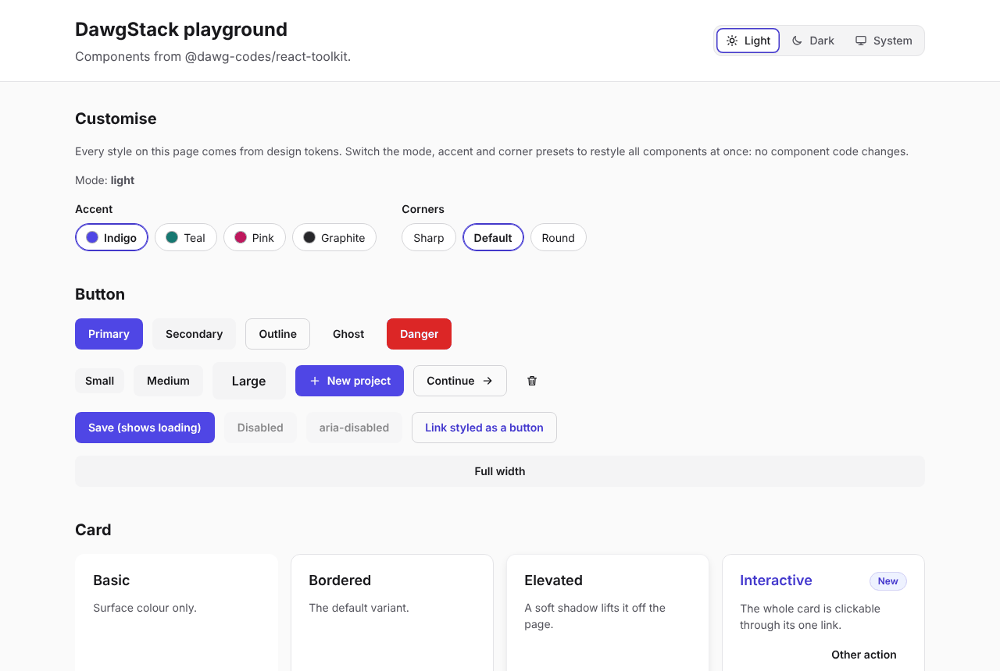
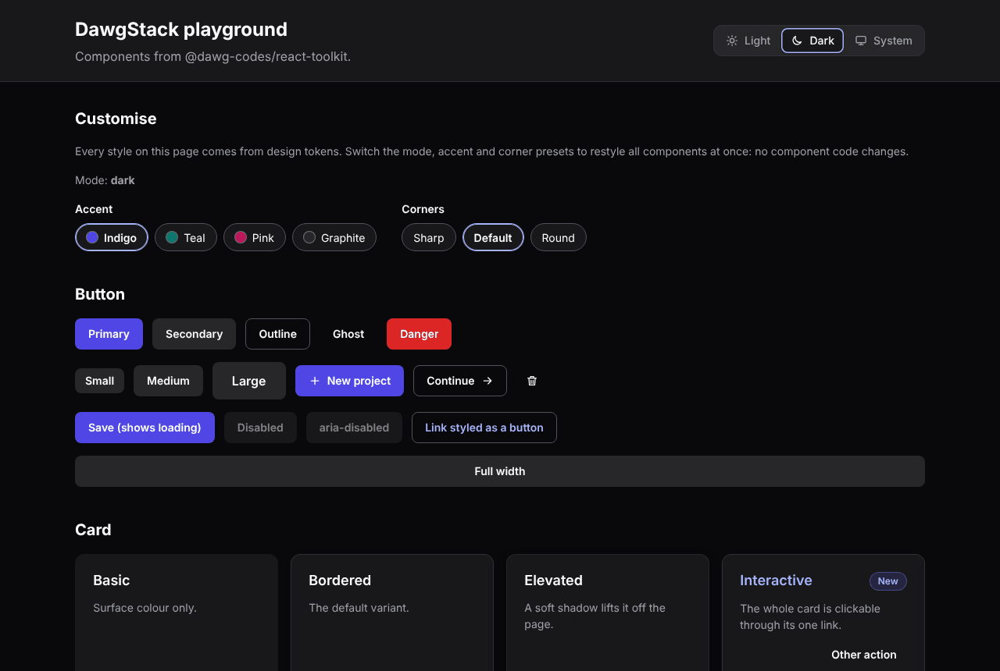
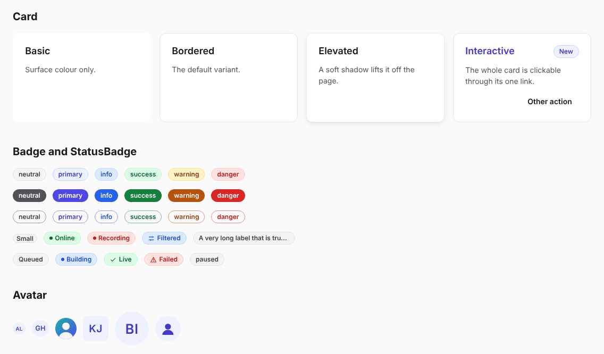
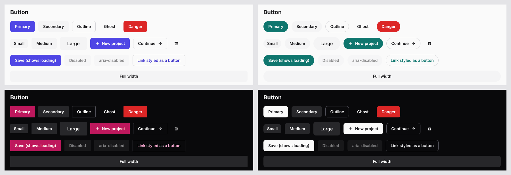
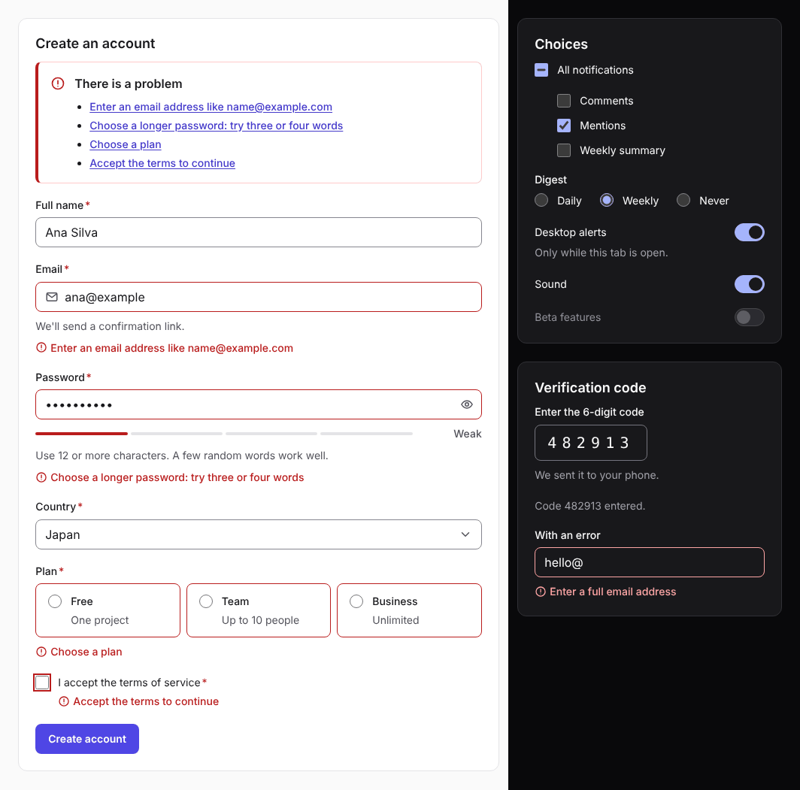
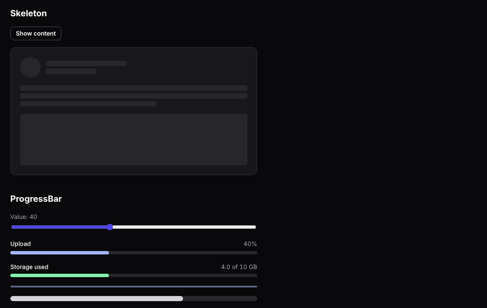
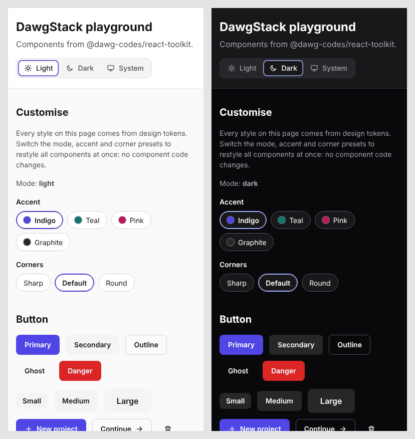
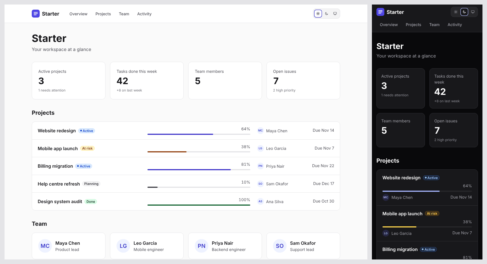

# DawgStack

**Build once. Stack smarter.**

DawgStack is an open-source React toolkit by Dawg Codes: reusable UI components, design tokens and developer utilities that help you build modern React applications without re-implementing the same basics in every project.

> **Status: early development.** Nothing is published to npm yet, and the API may change before the first release.

| Light                                                                | Dark                                                               |
| -------------------------------------------------------------------- | ------------------------------------------------------------------ |
|  |  |

## Features

- **Accessible components.** Buttons, cards, badges, avatars, loading states, form controls and more. They use semantic HTML and correct ARIA, work with the keyboard, and are tested with axe-core.
- **Themes users can switch.** A ready-made toggle for light, dark or follow-the-system. The choice is saved, follows the OS live, stays in sync across tabs, and never flashes the wrong theme on load.
- **Modular styling.** Mix and match accent presets (indigo, teal, pink, graphite) with shape presets (sharp, default, round), define your own typed theme, or give one part of a page its own theme.
- **Boilerplate templates.** Complete apps you copy and own. Use one as it is, or change a few clearly marked files: name, navigation, theme and where the data comes from.
- **Take only what you need.** Import all styles, just the components you use, or none and style everything yourself. Every component also has its own JavaScript entry point.
- **Customise without forking.** 108 tokens (91 design tokens and 17 per-component hooks), all in CSS cascade layers, so your own CSS always wins without `!important`.
- **Contrast you can trust.** Every colour pair in both themes and in every preset is tested against WCAG AA. Reduced motion, Windows High Contrast and right-to-left progress bars are handled.
- **Works anywhere.** React 18 and 19, ESM and CommonJS, TypeScript types, server rendering and React Server Components. React is the only peer dependency, and there are no runtime dependencies.

## A quick look

```tsx
import '@dawg-codes/react-toolkit/styles.css';
import { Button, Card, CardTitle, ProgressBar } from '@dawg-codes/react-toolkit';
import {
  ThemeProvider,
  ThemeToggle,
  accentPresets,
  mergeThemes,
  shapePresets,
} from '@dawg-codes/react-toolkit/theme';

const theme = mergeThemes(accentPresets.teal, shapePresets.round);

export function App() {
  return (
    <ThemeProvider theme={theme}>
      <ThemeToggle />
      <Card>
        <CardTitle>Storage</CardTitle>
        <ProgressBar value={72} label="Used" showValue />
        <Button variant="primary">Upgrade</Button>
      </Card>
    </ThemeProvider>
  );
}
```

## Screenshots

**Components**: cards (including an accessible clickable card), badges with typed statuses, and avatars with automatic fallbacks.



**Presets**: the same buttons under four theme modules. Clockwise from top left: indigo with default corners (light), teal with round corners (light), graphite (dark), and pink with sharp corners (dark).



**Forms**: validation with a summary that links to each field, a password strength meter, radio cards, switches, and a one-time code field (light and dark).



**Loading and progress**: skeleton placeholders, determinate, indeterminate and meter-style progress bars, in dark mode.



**On a phone**: the theme toggle and the Customise panel wrap to fit small screens.



## What's included

The [`@dawg-codes/react-toolkit`](packages/react-toolkit) package provides:

| Component             | Purpose                                                                 |
| --------------------- | ----------------------------------------------------------------------- |
| Button                | Five variants, three sizes, icons and an accessible loading state       |
| Card                  | Basic, bordered and elevated surfaces, plus accessible clickable cards  |
| Badge and StatusBadge | Status and category labels; typed mapping from your own status values   |
| Avatar                | Image with automatic fallback to initials, then an icon                 |
| Divider               | Horizontal, vertical and labelled separators                            |
| Spinner               | Loading indicator with an optional screen-reader label                  |
| Skeleton              | Text, block and circle loading placeholders                             |
| ProgressBar           | Determinate, indeterminate and meter-style bars                         |
| EmptyState            | "Nothing here yet" panels with an icon, explanation and actions         |
| Form controls         | Text, select, checkbox, radio, switch, search, password, one-time code  |
| VisuallyHidden        | Text for screen readers only                                            |
| Theme tools           | ThemeProvider, ThemeToggle, ThemeScope, presets and typed custom themes |

**See the [component documentation](packages/react-toolkit/README.md)** for props, examples, theming and known limitations.

## Templates

Templates are boilerplate: complete, runnable apps built from the toolkit. Copy one into your project and it's yours to use as it is or adapt. DawgStack keeps two layers apart:

| Layer                  | How you get it     | Updates                                             |
| ---------------------- | ------------------ | --------------------------------------------------- |
| Components and theming | Installed from npm | Bug fixes and improvements arrive with `npm update` |
| Templates              | Copied once        | Yours to change; nothing is locked in a package     |

Each template keeps the things you're most likely to change in a few obvious files: `app.config.ts` (name, navigation, which sections show), `theme.ts` (colours and corners), and `src/data/` (where data comes from).



| Template                     | What it is                                                                                | Status    |
| ---------------------------- | ----------------------------------------------------------------------------------------- | --------- |
| [Starter](templates/starter) | A themed dashboard: summary numbers, projects with status and progress, team and activity | Available |
| Sign-in pages                | Sign-in, one-time code and password reset screens                                         | Planned   |
| Admin dashboard              | App layout with side navigation, overview and settings                                    | Planned   |
| User management              | Searchable, sortable user table with bulk actions                                         | Planned   |

The planned templates need components that are still being built: app layout, dialogs and a data table. The form controls they use are ready.

```bash
pnpm starter                                                   # run it inside this repository
npx degit dawg-codes/DawgStack/templates/starter my-app        # copy it (once the toolkit is on npm)
```

See the [Starter README](templates/starter/README.md) for the full copy steps and where to change things.

## Try it locally

Requires Node.js 22.18+ and pnpm 10 (`corepack enable` sets up pnpm).

```bash
pnpm install
pnpm playground        # builds the library and opens a preview at http://localhost:5173
```

The playground shows every component, with live controls for the mode, accent and corner presets.

## Repository layout

```
packages/react-toolkit/   the component library (@dawg-codes/react-toolkit)
apps/playground/          local preview app that uses the built library
templates/                boilerplate apps to copy (see Templates above)
docs/screenshots/         images used in this README
tooling/                  repository checks
```

## Scripts

| Command              | What it does                                                                             |
| -------------------- | ---------------------------------------------------------------------------------------- |
| `pnpm check`         | Everything below in order, plus building the playground and every template: what CI runs |
| `pnpm lint`          | ESLint, including accessibility rules for JSX                                            |
| `pnpm format:check`  | Prettier                                                                                 |
| `pnpm typecheck`     | TypeScript (strict)                                                                      |
| `pnpm test`          | Unit, accessibility and colour-contrast tests (Vitest)                                   |
| `pnpm build`         | Builds the library into `packages/react-toolkit/dist`                                    |
| `pnpm check:package` | Checks the package's exports and types for every module system (publint, attw)           |
| `pnpm leak-guard`    | Fails if a file contains a blocked term                                                  |
| `pnpm playground`    | Runs the preview app                                                                     |
| `pnpm starter`       | Runs the Starter template                                                                |

### Adding a component

1. Create `packages/react-toolkit/src/components/<name>/` with the component, `index.ts`, `<name>.css` (wrapped in `@layer dawg.components`) and tests.
2. Export it from `packages/react-toolkit/src/index.ts`.
3. Run `pnpm --filter @dawg-codes/react-toolkit sync-exports` to update the package's entry points.
4. Run `pnpm check`.

## License

[MIT](LICENSE) © 2026 Dawg Codes
