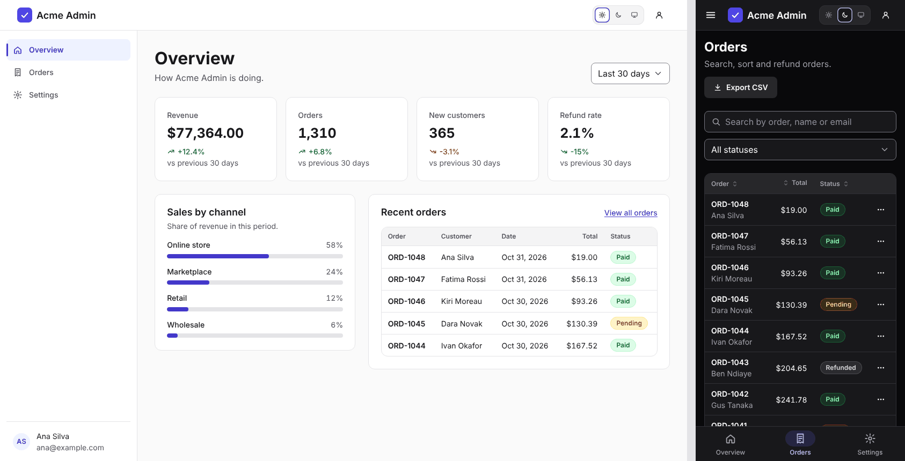

# DawgStack Admin dashboard

An admin app built with [`@dawg-codes/react-toolkit`](https://github.com/dawg-codes/DawgStack/blob/main/packages/react-toolkit): side navigation, an overview with key numbers, an orders table with search, sorting, export and refunds, and a settings page. Use it as it is, or change a few files to make it yours. Once copied, everything is yours: nothing is locked inside a package. Links in this file point to GitHub so they still work after you copy the folder.



## Get it

**Inside the DawgStack repository:**

```bash
pnpm install
pnpm admin-dashboard   # builds the toolkit, then opens http://localhost:5173
```

**As your own project.** This works once `@dawg-codes/react-toolkit` is published to npm; until then, use it inside the repository as above.

```bash
npx degit dawg-codes/DawgStack/templates/admin-dashboard my-admin
cd my-admin
npm pkg set "dependencies.@dawg-codes/react-toolkit=latest"   # replaces the repo-only link
npm install
npm run dev
```

## Pages

| Address      | Page                                                                                                                                 |
| ------------ | ------------------------------------------------------------------------------------------------------------------------------------ |
| `#/overview` | Key numbers with their change over a chosen period, sales by channel, and the latest orders                                          |
| `#/orders`   | Every order: search, filter by status, sort any column, page through, export to CSV, view details and refund                         |
| `#/settings` | Profile form, email notification switches, light/dark mode and accent colour, and deleting the workspace (with a typed confirmation) |

On computers the navigation is a sidebar. On tablets and phones it opens from the menu button, and phones also get a tab bar at the bottom.

## Where to change things

| To change                                            | Edit                                         |
| ---------------------------------------------------- | -------------------------------------------- |
| App name, signed-in person, which pages show, locale | `src/app.config.ts`                          |
| Default colours and corner shape                     | `src/theme.ts`                               |
| Calls to your backend                                | `src/data/api.ts` (one function each)        |
| The shape of your data                               | `src/data/types.ts`                          |
| Navigation labels, icons and order                   | `PAGES` in `src/App.tsx`                     |
| Order statuses: wording and colours                  | `ORDER_STATUS` in `src/components/parts.tsx` |
| Logo                                                 | `Brand` in `src/components/parts.tsx`        |
| A page's content                                     | `src/pages/`                                 |
| Money, number and date formats                       | `src/format.ts`                              |
| Page styles                                          | `src/styles.css`                             |

## Common changes

**Connect your backend.** Replace the body of each function in `src/data/api.ts` with a request to your server (there's an example at the top of the file). The pages only use those functions and the types in `src/data/types.ts`, so nothing else needs to change. Then delete `src/data/sample.ts`.

**Large order lists.** The Orders page loads every order, then searches, sorts and pages in the browser, which suits a few thousand rows. For more, add `query`, `status`, `sort` and `page` options to `loadOrders`, pass them from `src/pages/Orders.tsx`, and let your server do the work.

**Add a page.** Create a file in `src/pages/`, add its name to the `Page` type and `pages` in `src/app.config.ts`, and add it to `PAGES` in `src/App.tsx` with a label and icon. It appears in the sidebar, the drawer and the phone tab bar. (Phones have room for about five tabs.)

**Turn pages off.** In `src/app.config.ts`, set a page to `false` in `pages`. Its links disappear, and its address shows the first page that's on.

**Sign-in.** The app assumes someone is signed in: `account` in `src/app.config.ts` fills the account area, and `signOutHref` is where "Sign out" goes. The [Sign-in template](https://github.com/dawg-codes/DawgStack/tree/main/templates/sign-in) has the screens to send people to.

**Use a router.** Pages are switched by the URL hash in `src/router.ts`, so the template needs no extra packages. With a router such as `react-router`, make each file in `src/pages/` a route and pass your router's link component to `SideNav` and `MobileTabBar` with `renderLink`.

**Restyle.** People can pick light, dark or system mode and an accent colour in Settings, and both are remembered in their browser. To use your own brand colours instead, follow the comment in `src/theme.ts` and remove the accent picker from `src/pages/Settings.tsx`.

## Built in

**Loading and errors.** Every page shows placeholders while its data loads and a "Try again" message if loading fails. Changing the date range cancels the request for the previous one.

**Orders table:**

- Sorting applies to every order, not only the page on screen.
- Search and filters go back to page 1. When nothing matches, "Clear filters" resets them.
- Export CSV downloads the orders that match the current search and filter, with the status words as shown. The file opens correctly in Excel, and text that a spreadsheet would run as a formula is made safe.
- Refunds ask for confirmation first, and only paid orders can be refunded.

**Accessible:**

- A skip link, landmarks, and one `<h1>` per page. After moving between pages, focus goes to the new heading, so screen readers announce it.
- Works with the keyboard alone. Dialogs and the navigation drawer keep focus inside while open, and menus, dialogs and the drawer return focus to where it was when they close.
- Changes to green and red numbers are also shown with an arrow and a sign, so colour isn't the only clue.
- Light and dark mode with every accent, and screens from 320px wide. Every page passes axe-core checks, including colour contrast.

## Scripts

| Command             | What it does                        |
| ------------------- | ----------------------------------- |
| `npm run dev`       | Start the development server        |
| `npm run build`     | Type-check and build for production |
| `npm run preview`   | Serve the production build          |
| `npm run typecheck` | Type-check only                     |

## License

[MIT](LICENSE) © 2026 Dawg Codes
