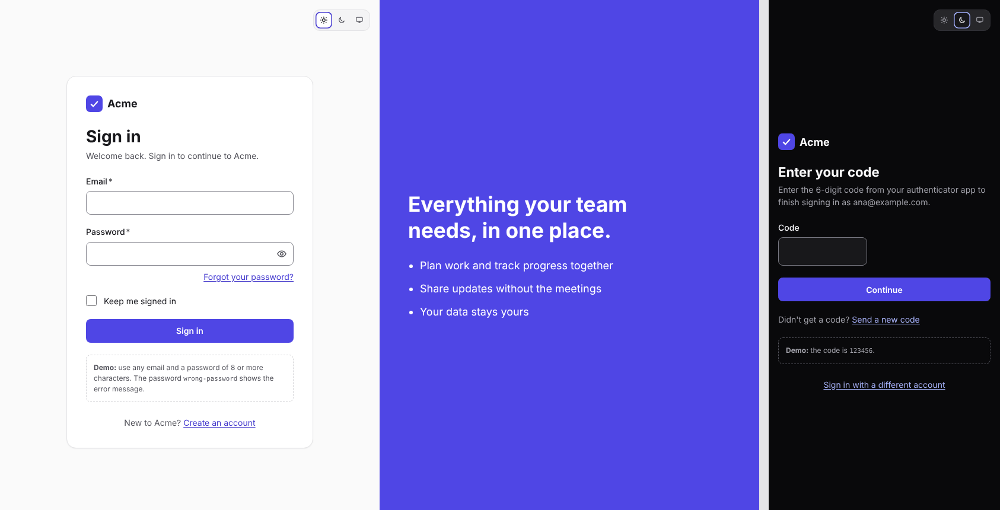

# DawgStack Sign-in

Sign-in, sign-up and password reset screens built with [`@dawg-codes/react-toolkit`](https://github.com/dawg-codes/DawgStack/blob/main/packages/react-toolkit). Use them as they are, or change a few files to make them yours. Once copied, everything is yours: nothing is locked inside a package. Links in this file point to GitHub so they still work after you copy the folder.



## Get it

**Inside the DawgStack repository:**

```bash
pnpm install
pnpm sign-in        # builds the toolkit, then opens http://localhost:5173
```

**As your own project.** This works once `@dawg-codes/react-toolkit` is published to npm; until then, use it inside the repository as above.

```bash
npx degit dawg-codes/DawgStack/templates/sign-in my-sign-in
cd my-sign-in
npm pkg set "dependencies.@dawg-codes/react-toolkit=latest"   # replaces the repo-only link
npm install
npm run dev
```

## Screens

| Address                    | Screen                                                                 |
| -------------------------- | ---------------------------------------------------------------------- |
| `#/sign-in`                | Email and password, "Forgot your password?", "Keep me signed in"       |
| `#/verify`                 | Two-step sign-in: a 6-digit code, with "Send a new code"               |
| `#/sign-up`                | Name, email and a new password with a strength meter                   |
| `#/forgot-password`        | Asks for the email to send a reset link to                             |
| `#/check-email`            | "Check your email" after signing up or asking for a reset, with resend |
| `#/reset-password?token=…` | Choose a new password, opened from the link in the email               |
| `#/signed-in`              | A placeholder for your app, with Sign out                              |

## Where to change things

| To change                                                        | Edit                                  |
| ---------------------------------------------------------------- | ------------------------------------- |
| App name, links, which screens and options show, password length | `src/app.config.ts`                   |
| Colours and corner shape                                         | `src/theme.ts`                        |
| Calls to your backend                                            | `src/auth/api.ts` (one function each) |
| Error messages and field checks                                  | `src/auth/messages.ts`                |
| Logo                                                             | `src/components/Brand.tsx`            |
| A screen's wording or fields                                     | `src/pages/`                          |
| Page styles                                                      | `src/styles.css`                      |

## Common changes

**Connect your backend.** Replace the body of each function in `src/auth/api.ts` with a request to your server (there's an example in `signIn`). The screens only use those functions, so nothing else needs to change. Then set `demo: false` in `src/app.config.ts` to remove the demo hints.

**Turn screens off.** In `src/app.config.ts`, set `features.signUp`, `forgotPassword`, `twoStep`, `rememberMe` or `sidePanel` to `false`. Links to a screen that's turned off disappear, and its address shows the sign-in screen.

**Send people to your app after signing in.** Set `afterSignInHref` in `src/app.config.ts`, then delete `src/pages/SignedIn.tsx`.

**Use a router.** The screens are switched by the URL hash in `src/router.ts`, so the template needs no extra packages. With a router such as `react-router`, make each file in `src/pages/` a route and replace `navigate()` and `href()`.

**Restyle.** In `src/theme.ts`, swap the accent (`indigo`, `teal`, `pink`, `graphite`) and shape (`sharp`, `default`, `round`) presets, or define your own colours with `defineTheme`.

## Try the demo

Until `src/auth/api.ts` talks to your backend, it follows these rules:

- Any email with a password of 8 or more characters signs in. The password `wrong-password` shows the error message.
- The two-step code is `123456`.
- After "Forgot your password?", the "Check your email" screen links to a working reset link.

## Built in

**Safe by default:**

- Error messages never reveal whether an email has an account: "The email or password is incorrect", and the same "Check your email" message whether or not an account exists.
- `autocomplete` is set on every field (`username`, `current-password`, `new-password`, `one-time-code`), so password managers and one-time-code autofill work, and pasting is never blocked.
- New passwords need a minimum length (12 by default) and show a strength meter. Long passphrases are encouraged rather than symbol rules.
- "Send again" buttons wait 30 seconds between sends.
- Email addresses are kept in memory, never in the URL, so they don't end up in browser history.

**Your server still needs to:** check everything again, rate-limit these endpoints, keep the session in an HttpOnly, Secure, SameSite cookie (not `localStorage`), protect against CSRF, check new passwords against breached-password lists, and make reset links expire after one use. The comments in `src/auth/api.ts` repeat this list.

**Accessible:**

- Each screen has one `<h1>`. After moving between screens, focus goes to the new heading, so screen readers announce it.
- Field problems appear next to each field and focus moves to the first one. Server errors appear in an alert that takes focus.
- Works with the keyboard alone, in light and dark mode, and on screens from 320px wide. Every screen passes axe-core checks, including colour contrast.

## Scripts

| Command             | What it does                        |
| ------------------- | ----------------------------------- |
| `npm run dev`       | Start the development server        |
| `npm run build`     | Type-check and build for production |
| `npm run preview`   | Serve the production build          |
| `npm run typecheck` | Type-check only                     |

## License

[MIT](LICENSE) © 2026 Dawg Codes
