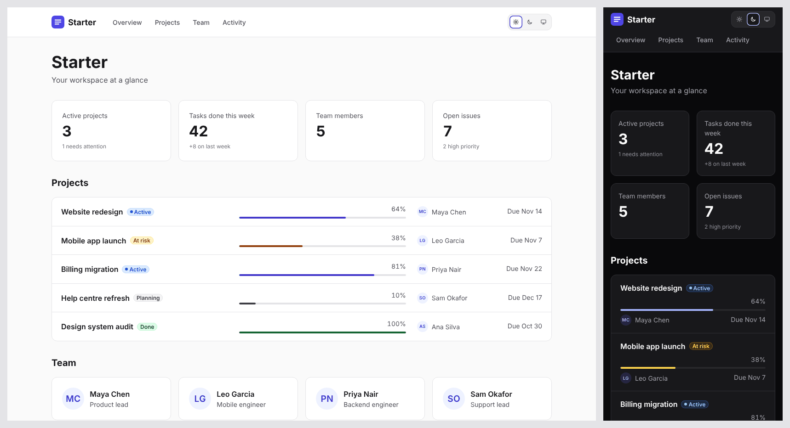

# DawgStack Starter

A themed dashboard app built with [`@dawg-codes/react-toolkit`](https://github.com/dawg-codes/DawgStack/blob/main/packages/react-toolkit). Use it as it is, or change a few files to make it yours. It's yours once copied: nothing here is locked inside a package. Links in this file point to GitHub so they still work after you copy the folder.



## Get it

**Inside the DawgStack repository:**

```bash
pnpm install
pnpm starter        # builds the toolkit, then opens http://localhost:5173
```

**As your own project.** This works once `@dawg-codes/react-toolkit` is published to npm; until then, use it inside the repository as above.

```bash
npx degit dawg-codes/DawgStack/templates/starter my-app
cd my-app
npm pkg set "dependencies.@dawg-codes/react-toolkit=latest"   # replaces the repo-only link
npm install
npm run dev
```

## Where to change things

| To change                                          | Edit                             |
| -------------------------------------------------- | -------------------------------- |
| App name, tagline, navigation, which sections show | `src/app.config.ts`              |
| Colours and corner shape                           | `src/theme.ts`                   |
| Where the data comes from                          | `src/data/api.ts` (one function) |
| The shape of the data                              | `src/data/types.ts`              |
| The demo data                                      | `src/data/sample.ts`             |
| What the dashboard shows                           | `src/pages/Dashboard.tsx`        |
| Header and logo                                    | `src/components/AppHeader.tsx`   |
| Page layout and spacing                            | `src/styles.css`                 |

## Common changes

**Restyle everything.** In `src/theme.ts`, swap the presets: accents are `indigo`, `teal`, `pink` and `graphite`; shapes are `sharp`, `default` and `round`. Or define your own colours with `defineTheme`; the comment in the file shows how.

**Connect your backend.** Replace the body of `loadDashboard()` in `src/data/api.ts` with a real request. Loading, error (with a retry button) and empty states are already handled.

**Hide a section.** Set `features.team` or `features.activity` to `false` in `src/app.config.ts`. The section and its navigation link disappear.

**Add more pages.** The navigation links go to sections on one page. For separate pages, add a router such as `react-router`, turn each `nav` item's `href` into a route, and put the new screens in `src/pages/`.

## What's included

- A dashboard with summary numbers, a project list with typed status badges and progress, team cards and recent activity
- Loading placeholders, an error state with retry, and an empty state, ready for real data
- Light, dark and system themes, remembered between visits, with no flash on load
- Accessible by default: a skip link, landmarks, keyboard support, and a page that passes axe-core checks (including colour contrast) in both themes
- Works on screens from 320px wide upwards

## Scripts

| Command             | What it does                        |
| ------------------- | ----------------------------------- |
| `npm run dev`       | Start the development server        |
| `npm run build`     | Type-check and build for production |
| `npm run preview`   | Serve the production build          |
| `npm run typecheck` | Type-check only                     |

## License

[MIT](LICENSE) © 2026 Dawg Codes
