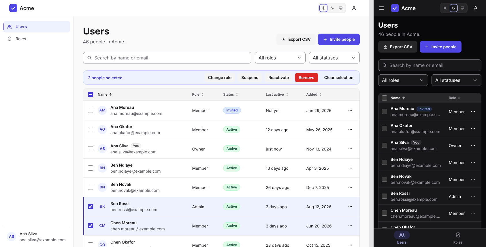

# DawgStack User management

Manage who has access, built with [`@dawg-codes/react-toolkit`](https://github.com/dawg-codes/DawgStack/blob/main/packages/react-toolkit): a searchable, sortable user table with bulk actions, invitations, roles and a details panel, plus a page that explains what each role can do. Use it as it is, or change a few files to make it yours. Once copied, everything is yours: nothing is locked inside a package. Links in this file point to GitHub so they still work after you copy the folder.



## Get it

**Inside the DawgStack repository:**

```bash
pnpm install
pnpm user-management   # builds the toolkit, then opens http://localhost:5173
```

**As your own project.** This works once `@dawg-codes/react-toolkit` is published to npm; until then, use it inside the repository as above.

```bash
npx degit dawg-codes/DawgStack/templates/user-management my-users
cd my-users
npm pkg set "dependencies.@dawg-codes/react-toolkit=latest"   # replaces the repo-only link
npm install
npm run dev
```

## Pages

| Address              | Page                                                                                                         |
| -------------------- | ------------------------------------------------------------------------------------------------------------ |
| `#/users`            | Everyone in the workspace: search, filter by role and status, sort, select and act on several people at once |
| `#/users?role=admin` | The same list, opened with a role chosen (the Roles page links here)                                         |
| `#/roles`            | Each role with what it's for and how many people have it, and a table of what each role can do               |

**On the Users page:**

- **Invite people:** paste up to 20 addresses at once and pick their role. Addresses that already belong to someone are skipped and listed.
- **Each person's menu:** view details, change role, resend or cancel an invitation, suspend or reactivate, and remove.
- **Select several people** (across pages) to change their role, suspend, reactivate or remove them together.
- **The details panel** shows role, status, last visit and when they were added, with the same actions.
- **Export CSV** downloads the people that match the current search and filters.

## Where to change things

| To change                                                      | Edit                                                    |
| -------------------------------------------------------------- | ------------------------------------------------------- |
| App name, who is signed in, rows per page, invite limit, pages | `src/app.config.ts`                                     |
| Role names, descriptions and the permissions table             | `src/roles.ts` (and the `Role` type)                    |
| Calls to your backend                                          | `src/data/api.ts` (one function each)                   |
| The shape of your data                                         | `src/data/types.ts`                                     |
| Error messages, and how pasted addresses are read              | `src/messages.ts`                                       |
| Status wording and colours                                     | `USER_STATUS` in `src/components/parts.tsx`             |
| Table columns and the CSV columns                              | `COLUMNS` and `EXPORT_COLUMNS` in `src/pages/Users.tsx` |
| Colours and corner shape                                       | `src/theme.ts`                                          |
| Logo                                                           | `Brand` in `src/components/parts.tsx`                   |
| Page styles                                                    | `src/styles.css`                                        |

## Common changes

**Connect your backend.** Replace the body of each function in `src/data/api.ts` with a request to your server (there's an example at the top of the file). The pages only use those functions, `ApiError` and the types in `src/data/types.ts`, so nothing else needs to change. Then delete `src/data/sample.ts`, and load the signed-in person from your session instead of `currentUserId` and the sample data in `src/App.tsx`.

**Your server decides.** The screens hide what people shouldn't do, but your server must check every request again: that the signed-in person may manage people, that nobody changes their own role or removes themselves, that at least one owner always remains, and that invitations are rate-limited. Return an error with a code, and `src/messages.ts` turns it into a sentence.

**Change the roles.** Edit `src/roles.ts`: the order, names, descriptions and the permissions table all come from there. If you add or rename a role, update the `Role` type in `src/data/types.ts` to match; TypeScript then points to anything else that needs it.

**Large teams.** The Users page loads everyone, then searches, sorts and pages in the browser, which suits a few thousand people. For more, add `query`, `role`, `status`, `sort` and `page` options to `loadUsers`, pass them from `src/pages/Users.tsx`, and let your server do the work.

**Use a router.** Pages are switched by the URL hash in `src/router.ts`, so the template needs no extra packages. With a router such as `react-router`, make each file in `src/pages/` a route and pass your router's link component to `SideNav` and `MobileTabBar` with `renderLink`.

**Restyle.** In `src/theme.ts`, swap the accent (`indigo`, `teal`, `pink`, `graphite`) and shape (`sharp`, `default`, `round`) presets, or define your own colours with `defineTheme`.

## Try the demo

Until `src/data/api.ts` talks to your backend, it works on 46 made-up people, and changes last until the page reloads. You're signed in as Ana Silva, an owner:

- Your own row only offers View details, and selecting yourself for a bulk change shows the error your server would send.
- Inviting an address that's already here (such as `ben.rossi@example.com`) skips it and says so.

## Built in

**Careful with changes:**

- Removing people and cancelling invitations ask first. Suspending doesn't, but its message has an Undo button.
- Changing a filter or search clears the selection, so a bulk action never touches people you can't see. Moving between pages keeps it.
- Sorting covers everyone, not only the page on screen. Roles sort by rank (owners first), not alphabetically.
- Export CSV includes emails and uses the words shown on screen. The file opens correctly in Excel, and text that a spreadsheet would run as a formula is made safe.

**Accessible:**

- A skip link, landmarks, and one `<h1>` per page. After moving between pages, focus goes to the new heading.
- Every checkbox and menu is named after its person, such as "Select Ben Rossi" and "Actions for Ben Rossi".
- Dialogs keep focus inside while open and return it afterwards. If the person whose button opened them was removed, focus goes to the page heading instead of being lost.
- The permissions table reads its ticks and dashes as "Yes" and "No".
- Works in light and dark mode and on screens from 320px wide. On narrow screens, the table hides the Status column and shows any status other than Active next to the name. Every page passes axe-core checks, including colour contrast.

## Scripts

| Command             | What it does                        |
| ------------------- | ----------------------------------- |
| `npm run dev`       | Start the development server        |
| `npm run build`     | Type-check and build for production |
| `npm run preview`   | Serve the production build          |
| `npm run typecheck` | Type-check only                     |

## License

[MIT](LICENSE) © 2026 Dawg Codes
